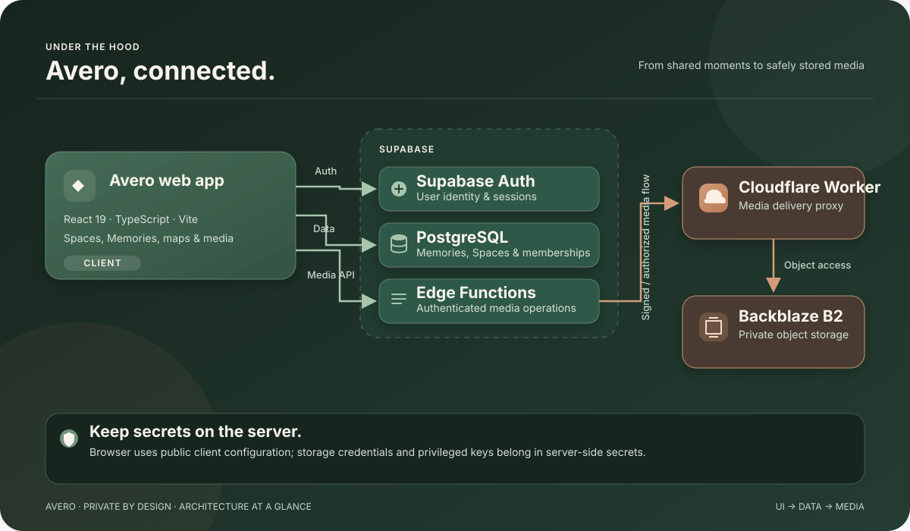

<!--
  AVERO — repository README
  Built for GitHub Markdown. Animated visuals use external SVG endpoints.
  Update the links and screenshots only when a real public URL/assets are available.
-->

<div align="center">

<a href="https://github.com/farazkayan/Avero">
  
</a>

<br />


<br />

<p>
  <a href="https://github.com/farazkayan/Avero/stargazers"></a>
  <a href="https://github.com/farazkayan/Avero/network/members"></a>
  <a href="https://github.com/farazkayan/Avero/commits/main"></a>
  
</p>

<p>
  
  
  
  
  
</p>

<br />

**[Explore the code](https://github.com/farazkayan/Avero)** &nbsp; · &nbsp; **[Open an issue](https://github.com/farazkayan/Avero/issues)**

</div>

---

## The moments are the point.

Avero is a **private, shared memory journal** for friends, families, couples, and groups to keep the moments that make their lives theirs.

Not another feed to keep up with. Not a contest for attention. Just a shared place for the stories, photos, places, and small details you want to remember — together.

> **Keep the memory. Keep the meaning.**

Avero is actively being built, so its features and setup may evolve as the project grows.

## What lives in Avero?

<table>
  <tr>
    <td width="50%" valign="top">
      <h3>🫶 Shared Spaces</h3>
      Make a space for your people. Bring members together around a shared collection of moments.
    </td>
    <td width="50%" valign="top">
      <h3>📸 Memories, not posts</h3>
      Save a moment with its story, date, type, place, and the details that make it matter.
    </td>
  </tr>
  <tr>
    <td width="50%" valign="top">
      <h3>🗺️ Places that matter</h3>
      Attach locations to memories and explore them through a map-based view.
    </td>
    <td width="50%" valign="top">
      <h3>🎞️ Photos & videos</h3>
      Add media to memories, with a dedicated storage pipeline and thumbnail processing.
    </td>
  </tr>
  <tr>
    <td width="50%" valign="top">
      <h3>💬 Shared context</h3>
      Leave comments and reactions, and organize moments with tags.
    </td>
    <td width="50%" valign="top">
      <h3>⏳ Echoes</h3>
      Revisit memories from this day in the past and see meaningful moments resurface.
    </td>
  </tr>
</table>

### What Avero is intentionally not

- No public popularity contest or follower-count-first experience.
- No engagement loop designed to keep you scrolling forever.
- No treating meaningful moments as disposable content.

The goal is simple: make it easier to keep a life well remembered.

## A look at the architecture

<p align="center">
  
</p>

<details>
  <summary><strong>How the pieces fit together</strong></summary>
  <br />

  - **Web app** — the React application lives in `app/avero/` and uses React Router for navigation.
  - **Identity and data** — Supabase provides authentication and PostgreSQL-backed application data.
  - **Media operations** — Supabase Edge Functions handle authenticated media operations and thumbnail processing.
  - **Media delivery** — the Cloudflare Worker proxies access to a Backblaze B2 bucket; the required storage credentials stay in server-side secrets, not in the browser app.
</details>

## Built with

<div align="center">

| Layer | Technology |
|:--|:--|
| UI | [React 19](https://react.dev/) · [TypeScript](https://www.typescriptlang.org/) |
| Development & build | [Vite](https://vite.dev/) · [Tailwind CSS](https://tailwindcss.com/) |
| Navigation | [React Router](https://reactrouter.com/) |
| Auth & database | [Supabase](https://supabase.com/) · PostgreSQL |
| Maps | [Leaflet](https://leafletjs.com/) · [React Leaflet](https://react-leaflet.js.org/) |
| Server-side media | [Supabase Edge Functions](https://supabase.com/docs/guides/functions) · [Cloudflare Workers](https://workers.cloudflare.com/) · [Backblaze B2](https://www.backblaze.com/cloud-storage) |

</div>

## Get it running locally

### 1. Prerequisites

- A supported [Node.js](https://nodejs.org/) installation with npm.
- A Supabase project and its project URL and publishable key.
- Optional map/geocoding API keys if you want to exercise the location features.

### 2. Clone and install

```bash
git clone https://github.com/farazkayan/Avero.git
cd Avero
npm install
```

### 3. Configure the environment

Create a local `.env` file from the example:

**Windows PowerShell**

```powershell
Copy-Item .env.example .env
```

**macOS / Linux**

```bash
cp .env.example .env
```

Add your values to `.env`:

```dotenv
VITE_SUPABASE_URL=https://your-project.supabase.co
VITE_SUPABASE_PUBLISHABLE_KEY=your-supabase-publishable-key
VITE_CARTO_API_KEY=your-carto-api-key
VITE_LOCATIONIQ_API_KEY=your-locationiq-api-key
```

The Supabase URL and publishable key are needed for the app to connect to your project. The map-related keys support location features. Use the variable names in `.env.example` exactly.

> **Security note:** `VITE_*` values are bundled into client-side code. Only put values intended to be public there. Never put Supabase service-role credentials, Backblaze application keys, or media-worker secrets in the frontend `.env` file. Configure server-side secrets in the relevant Supabase/Cloudflare environment instead.

### 4. Start the development server

```bash
npm run dev
```

Vite serves the app on the local development URL printed in your terminal (the workspace dev script uses port `3000`).

### 5. Check the project

```bash
npm run lint
npm run build
```

These run the workspace's ESLint checks and production TypeScript/Vite build.

<details>
  <summary><strong>Want to work on media infrastructure too?</strong></summary>
  <br />

  The repository also contains `supabase/` Edge Functions and a `cloudflare-worker/` media proxy. Running the frontend alone does **not** deploy or configure those services. Review the Supabase configuration and `cloudflare-worker/wrangler.toml`, then set required server-side secrets through the relevant provider tooling before testing media features end-to-end.
</details>

## Repository map

```text
Avero/
├── app/
│   └── avero/             # React + TypeScript web app
├── cloudflare-worker/     # Cloudflare media proxy
├── supabase/              # Supabase configuration and Edge Functions
├── Logo/                  # Project branding assets
├── .env.example           # Frontend environment variable template
├── package.json           # npm workspace scripts
└── README.md
```

## The philosophy

Avero is built around a few simple ideas:

- **People over metrics.** The value of a memory isn't how many people saw it.
- **Context over content.** The details and story matter as much as the photo.
- **Together, by design.** Memories can live in a space shared with the people who were there.
- **Remembering should feel natural.** The product should help moments resurface, not demand constant attention.

## Follow the build

Avero is under active development. The repository is the best place to follow the implementation and current changes.

<p align="center">
  <a href="https://github.com/farazkayan/Avero/commits/main"></a>
  <a href="https://github.com/farazkayan/Avero/issues"></a>
</p>

<div align="center">

*For the people, places, and tiny details you never want to lose.*


</div>
