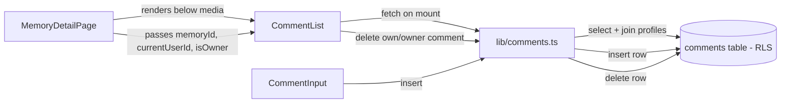

# Plan: Comments on the Memory Detail Page

Feature-specs §4 (Comments) · database §8 (Comments)

## Context & key discovery

The **entire backend for Comments already exists** — no new migration is needed:

- **Table** — [`comments`](../supabase/migrations/20260703170100_tables.sql:179) is created in the tables migration with `id`, `memory_id` (FK CASCADE), `user_id` (FK CASCADE), `content` (NOT NULL), `created_at`, `updated_at`. Hard delete only (no `deleted_at`) — matches feature-specs §4 "no soft delete for MVP".
- **RLS policies** — [`comments_select`](../supabase/migrations/20260703171000_rls_policies.sql:417), [`comments_insert`](../supabase/migrations/20260703171000_rls_policies.sql:428), [`comments_update`](../supabase/migrations/20260703171000_rls_policies.sql:440), [`comments_delete`](../supabase/migrations/20260703171000_rls_policies.sql:448) are all defined.
- **Index** — [`idx_comments_memory_created`](../supabase/migrations/20260703170300_indexes.sql:117) on `(memory_id, created_at)` serves the chronological read.
- **Grants** — [`comments`](../supabase/migrations/20260705210000_grant_table_privileges.sql:27) has SELECT/INSERT/UPDATE/DELETE granted to `authenticated`.

So this is a **frontend-only** task: types, a lib helper, a component, and wiring into `MemoryDetailPage`.

## The moderation question (flagged per the task brief)

The brief asks whether only the author can delete, or whether the Space owner should also moderate. **The backend already answers this:** the [`comments_delete`](../supabase/migrations/20260703171000_rls_policies.sql:448) policy is

```sql
USING (
    user_id = auth.uid()
    OR is_space_owner((SELECT space_id FROM memories WHERE id = comments.memory_id))
)
```

i.e. **author OR Space owner**. This mirrors the existing media-delete pattern (`media_delete` = memory creator OR owner) and the memories delete policy. The docs (feature-specs §4 / database §8) don't explicitly state who may delete comments, but the RLS policy is the system of record and it already grants owner moderation.

**Decision (confirmed):** the UI shows the delete affordance to the **comment author OR a Space owner** (matching the RLS policy exactly). This is consistent with the rest of the app and requires no backend change.

## Architecture



### Files to create

1. **`app/avero/src/types/comment.ts`** — `Comment` type (`id`, `memory_id`, `user_id`, `content`, `created_at`, `updated_at`) + `CommentWithAuthor` (adds `author_name` from the joined `profiles` row). Mirrors the style of [`types/media.ts`](../app/avero/src/types/media.ts:1).

2. **`app/avero/src/lib/comments.ts`** — the single home for the three comment operations, mirroring [`lib/media.ts`](../app/avero/src/lib/media.ts:1):
   - `fetchMemoryComments(memoryId): Promise<CommentWithAuthor[]>` — `select("*, profiles(name)")` ordered `created_at ASC` (chronological — feature-specs §4). Flatten the join like `fetchMemoryTags` does. RLS auto-filters to Space members.
   - `addComment({ memoryId, content }): Promise<{ ok, comment } | { ok: false, error }>` — insert with `user_id` set to `auth.uid()` via the session (the `comments_insert` WITH CHECK enforces `user_id = auth.uid()`). Returns the inserted row + author name so it can be appended without a refetch. Never throws (calm error result, like `uploadMediaItem`).
   - `deleteComment(commentId): Promise<{ ok } | { ok: false, error }>` — `delete().eq("id", commentId)`. RLS gates author-or-owner. Never throws.
   - `MAX_COMMENT_LENGTH` constant (e.g. 1000 chars) — keeps the UI calm; the `content` column is `text` with no CHECK, so this is a client-side guard like `MAX_TAG_LENGTH`.

3. **`app/avero/src/components/comments/CommentList.tsx`** — the section rendered below the media gallery. Owns:
   - fetch-on-mount effect (cancelled flag pattern, exactly like `MediaGallery`'s row fetch).
   - loading skeleton, calm load-error, empty state ("No comments yet — be the first to add to this memory.").
   - the comment list (author name, content with `whitespace-pre-line`, formatted timestamp).
   - delete affordance per comment, gated to `comment.user_id === currentUserId || isOwner` (matches RLS). Uses the **inline two-step confirm** pattern from `MediaTile` (not the full-screen `ConfirmDialog`) — "Delete this comment? [Delete] [Cancel]" — so a single accidental click can't remove a comment. On confirm, optimistic removal from local state; on error, calm revert.
   - renders `<CommentInput>` for adding.

4. **`app/avero/src/components/comments/CommentInput.tsx`** — textarea + submit. Visible to any Space member (the page is already member-gated by RLS, so if you can see the Memory you can comment). Submit calls `addComment`; on success the new comment is appended to the list immediately (no reload). Disabled while submitting; shows a calm inline error on failure. Clears on success. Enter-to-submit optional (Cmd/Ctrl+Enter to submit, plain Enter for newline — avoids accidental submits on a textarea).

### Files to modify

5. **`app/avero/src/pages/MemoryDetailPage.tsx`** — render `<CommentList>` below `<MediaGallery>` inside the `memory ?` branch. Pass `memoryId={memory.id}`, `currentUserId={user?.id}`, and `isOwner` (the page already computes `isOwner` from the members fetch). No new data fetching on the page itself — the component is self-contained, matching how `MediaGallery` is self-contained.

### No backend changes

No new migration. The table, RLS, index, and grants are all present. (If a `content` length CHECK is desired server-side, that would be a small follow-up migration, but it's not required for MVP and the client guard is sufficient.)

## Patterns reused (consistency)

| Concern | Existing pattern | Reused for comments |
|---|---|---|
| Auth gate | `ProtectedRoute` + RLS | Same — page already member-gated |
| Loading | centered `<Spinner>` with `role="status"` | skeleton list (like `MediaGallery`) |
| Error | calm `text-error` in `bg-canvas-soft` box | same |
| Not-found/no-access | RLS returns no rows → calm state | n/a (page handles; comments just empty) |
| Empty state | `EmptyState` component | "No comments yet" |
| Optimistic add | `MediaGallery` appends row, no reload | append comment to local state |
| Delete confirm | `MediaTile` inline two-step overlay | inline two-step on the comment row |
| Delete gate | `media_delete` = creator OR owner | `comments_delete` = author OR owner |
| Lib never throws | `uploadMediaItem` / `deleteMedia` return `{ok, error}` | `addComment` / `deleteComment` same |
| Timestamp format | `formatMemoryDate` locale-aware | a `formatCommentTime` relative/absolute helper |

## UI details

- Section heading: a small "Comments" label (h2) above the list, calm, not loud.
- Each comment: author name (medium weight, `text-ink`), content (`text-ink-muted`, `whitespace-pre-line`), timestamp (`text-xs text-ink-muted`).
- Delete affordance: a small trash icon (reuse `TrashIcon`) appearing on hover/focus over your own / owner-moderatable comments — calm, not always-visible (Design System §6/§8), mirroring `MediaTile`.
- Input: textarea with the same input styling as `TextField` (border, focus ring in accent), a submit button styled like the `Create Memory` link button (accent-600). Character count near the limit is optional.
- New comments appear at the **bottom** (chronological ASC), immediately, without scroll-jarring the user more than necessary.

## Open question for you

The only real decision is the **delete-permission UI gate**:
- **(A) Author OR Space owner** — matches the existing RLS policy and the media-delete precedent. *Recommended.*
- **(B) Author only** — stricter UI than the backend allows; owner-delete stays a latent capability.

I've planned for (A). Confirm or override.

## Implementation order (for the Code mode pass)

1. `types/comment.ts`
2. `lib/comments.ts` (fetch / add / delete + length constant)
3. `components/comments/CommentInput.tsx`
4. `components/comments/CommentList.tsx` (fetch, render, delete, empty state)
5. wire `CommentList` into `MemoryDetailPage.tsx`
6. manual smoke test (add, chronological order, delete own, owner-delete-other, empty state, error states)
