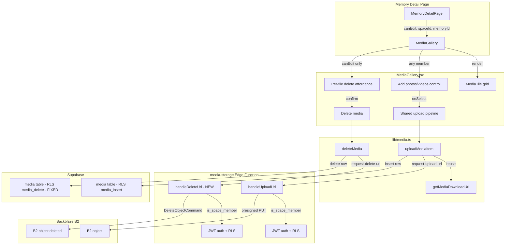

# Plan: Add & Remove Media on an Existing Memory

## Objective

Add the ability to add and remove media (photos/videos) on an existing Memory from the Memory Detail page's gallery ([`MediaGallery.tsx`](app/avero/src/components/media/MediaGallery.tsx)). Reuse the existing upload pipeline from [`CreateMemoryPage.tsx`](app/avero/src/pages/CreateMemoryPage.tsx) and mirror the cleanup rigor of Space/Memory deletion for deletes.

## Key Decisions (confirmed with user)

1. **Server-side fix — REMOVE only:** The current [`media_delete`](supabase/migrations/20260703171000_rls_policies.sql:312) RLS policy only allows `is_memory_creator`. This is inconsistent with [`memories_delete`](supabase/migrations/20260703171000_rls_policies.sql:257) (creator OR owner) and the Storage [`media_delete`](supabase/migrations/20260703170800_storage.sql:160) policy (creator OR owner). A new migration will align `media_delete` to **creator OR Space owner**.

2. **ADD stays as-is:** [`media_insert`](supabase/migrations/20260703171000_rls_policies.sql:293) and the Edge Function's `request-upload-url` action check `is_space_member` only. This matches the intentional design in [`backend-implementation.md`](docs/backend-implementation.md) §11.4 ("media INSERT = Member of the space"). The "Add photos/videos" control will be visible to **any Space member**.

3. **DELETE UI gating:** The per-thumbnail delete affordance is gated to `canEdit` (creator OR owner), reusing the exact logic already in [`MemoryDetailPage.tsx`](app/avero/src/pages/MemoryDetailPage.tsx:180) / [`EditMemoryPage.tsx`](app/avero/src/pages/EditMemoryPage.tsx:287).

4. **Delete ordering — DB first, then B2:** Delete the `media` row first (RLS-gated), then delete the B2 object via a new Edge Function action. If the B2 delete fails, the orphan is non-fatal (the row is already gone, so the gallery updates; a future cleanup pass can sweep orphans). This mirrors the upload pattern where a failed DB insert after a successful B2 PUT leaves an orphan, and is safer than B2-first (which would leave a ghost media row if the DB delete failed).

5. **No existing B2 cleanup pattern:** Space deletion relies on DB CASCADE only (orphaned B2 objects). [`backend-implementation.md`](docs/backend-implementation.md) §13.4 says media deletion "should be handled by a trigger or Edge Function" but it is not implemented. This feature establishes the first B2 object deletion path.

## Architecture Overview



## Detailed Steps

### Step 1 — Migration: fix `media_delete` RLS policy

**File:** `supabase/migrations/20260722090000_fix_media_delete_policy.sql` (new)

**Why:** Align the `media` table DELETE policy with `memories_delete` and the Storage `media_delete` policy, so a Space owner can remove media (not just the Memory creator). This is the only server-side change.

**Change:**
```sql
-- Recreate media_delete to allow creator OR Space owner, matching
-- memories_delete (20260703171000) and the Storage media_delete policy
-- (20260703170800). Previously only is_memory_creator was allowed, which
-- blocked Space owners from cleaning up media on memories they don't own.
DROP POLICY IF EXISTS media_delete ON media;
CREATE POLICY media_delete
    ON media
    FOR DELETE
    TO authenticated
    USING (
        is_memory_creator(memory_id)
        OR is_space_owner(
            (SELECT space_id FROM memories WHERE id = media.memory_id)
        )
    );
```

The subquery `(SELECT space_id FROM memories WHERE id = media.memory_id)` is subject to memories RLS (excludes soft-deleted), matching the pattern already used by [`media_select`](supabase/migrations/20260703171000_rls_policies.sql:283) and [`media_insert`](supabase/migrations/20260703171000_rls_policies.sql:293).

### Step 2 — Edge Function: add `request-delete-url` action

**File:** [`supabase/functions/media-storage/index.ts`](supabase/functions/media-storage/index.ts) (edit)

**Why:** There is no way to delete a B2 object today. Add a `request-delete-url` action that re-derives the `space_id` from the file key (same as `handleDownloadUrl`), re-checks Space membership via the caller's JWT, and issues a `DeleteObjectCommand` against B2.

**Changes:**
- Import `DeleteObjectCommand` from `npm:@aws-sdk/client-s3@3`.
- Add `ACTION_DELETE = "request-delete-url"` constant.
- Add `DeleteRequestBody` interface (`{ action, file_key }`) and extend the `ActionRequest` union.
- Add `handleDeleteUrl(body, user, supabase)`:
  - Validate `file_key` is non-empty.
  - Re-derive `spaceId` via existing [`parseSpaceIdFromKey`](supabase/functions/media-storage/index.ts:193) (same guard as download).
  - Membership check via existing [`isSpaceMember`](supabase/functions/media-storage/index.ts:263) (RLS-enforced via caller JWT).
  - Issue `DeleteObjectCommand` with the bucket + key, return `{ deleted: true }` on success.
  - Map `ConfigurationError` → 500, other → 502 (same as upload/download handlers).
- Route `ACTION_DELETE` in the `Deno.serve` entry point alongside upload/download.

**Note on authorization:** The Edge Function checks `is_space_member` (any member can request a delete URL). The actual authorization gate for *who may delete* is enforced by the `media_delete` RLS policy on the DB row delete (Step 1). The B2 delete itself is non-fatal orphan cleanup, so member-level access to the delete URL is acceptable — the DB row delete is the real gate. This mirrors how `request-download-url` checks membership but the real read gate is `media_select` RLS.

### Step 3 — `lib/media.ts`: extract shared upload pipeline + add delete helper

**File:** [`app/avero/src/lib/media.ts`](app/avero/src/lib/media.ts) (edit)

**Why:** The upload pipeline (classify → compress → invoke → PUT → insert row) currently lives inline in [`CreateMemoryPage.tsx`](app/avero/src/pages/CreateMemoryPage.tsx:408). To reuse it exactly in the gallery without duplicating ~80 lines, extract it into a shared, testable helper. Also add a `deleteMedia` helper that deletes the DB row then the B2 object.

**New exports:**

1. `uploadMediaItem(params): Promise<UploadResult>` — extracted from `CreateMemoryPage.uploadOneFile`:
   - Params: `{ file, spaceId, memoryId, onStatus }` where `onStatus` lets the caller observe `compressing` / `uploading` / `done` / `failed` transitions.
   - Reuses the same constants (`MAX_IMAGE_EDGE_PX`, `MAX_VIDEO_SIZE_BYTES`, `GENERIC_UPLOAD_ERROR`) and helpers (`classifyMediaType`, `loadImageFromFile`, `canvasToBlob`). Move these into `lib/media.ts` (or a new `lib/media-upload.ts` if `media.ts` should stay download-only) and re-export them so `CreateMemoryPage` can import from one place.
   - Returns `{ ok: true; media: Media }` (the inserted row) or `{ ok: false; error: string }`.

2. `deleteMedia(media): Promise<DeleteResult>` — new:
   - Step A: `supabase.from("media").delete().eq("id", media.id)` (RLS-gated by `media_delete`).
   - Step B: on success, invoke `request-delete-url` with `media.storage_path` (or `media.url`) to delete the B2 object. If B2 delete fails, return `{ ok: true; b2Orphaned: true }` — the row is gone, gallery updates; the orphan is non-fatal and logged.
   - If the DB delete fails (RLS denied or error), return `{ ok: false; error }` and do NOT attempt B2 delete (no orphan created).
   - Never throws — returns a result type, matching the `getMediaDownloadUrl` pattern.

**Refactor scope:** Update [`CreateMemoryPage.tsx`](app/avero/src/pages/CreateMemoryPage.tsx) to call `uploadMediaItem` instead of its inline `uploadOneFile`, so there is exactly one upload pipeline. This keeps the create flow behavior identical while removing duplication.

### Step 4 — `MediaGallery.tsx`: add control + delete affordance

**File:** [`app/avero/src/components/media/MediaGallery.tsx`](app/avero/src/components/media/MediaGallery.tsx) (edit)

**Props change:**
```ts
type MediaGalleryProps = {
  memoryId: string;
  spaceId: string;      // NEW — needed for upload (object key + Edge Function)
  canAdd: boolean;      // NEW — any Space member can add (always true on detail page)
  canEdit: boolean;     // NEW — creator OR owner; gates delete affordances
};
```

**Add media control (visible when `canAdd`):**
- A dashed-border "Add photos/videos" dropzone above the grid, reusing the exact markup/classes from [`CreateMemoryPage.tsx`](app/avero/src/pages/CreateMemoryPage.tsx:700) (the `<label htmlFor="media-files">` block) so the visual language is identical.
- Hidden `<input type="file" multiple accept="image/*,video/*">`.
- On select: classify + validate each file (reuse `classifyMediaType`, `MAX_VIDEO_SIZE_BYTES`), then for each valid file call `uploadMediaItem` with `onStatus` callbacks that drive a small inline per-file status list (reuse the `STATUS_LABELS` pattern from CreateMemoryPage).
- On each successful upload, append the returned `Media` row to `rows` and seed its `tile` as `loading` so the existing URL-resolution effect picks it up — **no full reload**. The new tile resolves its presigned URL and appears in place.
- Failed uploads show a calm per-file error with a Retry control (same pattern as CreateMemoryPage).

**Delete affordance (visible when `canEdit`):**
- Interaction pattern: a small trash icon button that appears on **hover/focus** over each tile (calm, not always-visible, per Design System §6/§8 — "visually calm and not accidental-click-prone"). Use `group` + `group-hover:opacity-100` + `focus-within:opacity-100` so it's keyboard-accessible.
- Clicking the trash icon opens a lightweight confirm. Per the task ("not a full modal necessarily, but something that prevents an accidental single-click"), use an **inline two-step confirm** rendered as a small popover/overlay on the tile itself: the tile swaps to a "Delete this photo? [Delete] [Cancel]" state. This is lighter than the full-screen [`ConfirmDialog`](app/avero/src/components/ui/ConfirmDialog.tsx) but still requires a deliberate second action. (If the inline popover proves awkward on small screens, fall back to `ConfirmDialog` — but start with the inline pattern to keep the gallery self-contained.)
- On confirm: call `deleteMedia(media)`. On success, remove the row from `rows` and its entry from `tiles` — **no full reload**. If it was the last item, `items.length === 0` and the gallery returns `null` (Task 1 empty state preserved).
- On failure: show a calm error on the tile and revert to the normal state (do not remove the row).

**New icon:** Add a `TrashIcon` to [`app/avero/src/components/ui/icons.tsx`](app/avero/src/components/ui/icons.tsx) matching the existing outline style (strokeWidth 1.5, 20×20, `aria-hidden`).

**Empty state:** When `rows.length === 0` AND `canAdd` is true, render the "Add photos/videos" control alone (so an authorized member can add the first photo to an empty Memory). When `canAdd` is false and there's no media, return `null` as today.

### Step 5 — `MemoryDetailPage.tsx`: pass new props

**File:** [`app/avero/src/pages/MemoryDetailPage.tsx`](app/avero/src/pages/MemoryDetailPage.tsx) (edit)

**Changes:**
- The page already computes `canEdit` ([`isCreator || isOwner`](app/avero/src/pages/MemoryDetailPage.tsx:184)) and already fetches `members` for the owner check.
- Pass to `MediaGallery`:
  ```tsx
  <MediaGallery
    memoryId={memory.id}
    spaceId={spaceId!}
    canAdd={true}        // any Space member can add (RLS media_insert = is_space_member)
    canEdit={canEdit}    // creator OR owner — gates delete
  />
  ```
- `canAdd` is effectively always true on this page (a non-member can't even see the Memory due to `memories_select` RLS), but passing it explicitly keeps the gallery reusable and makes the gating self-documenting.

### Step 6 — Verify end-to-end

- **Add:** Selecting files runs the shared pipeline; new tiles appear without reload; failed uploads show retry.
- **Remove:** Delete affordance only shows for creator/owner; confirm prevents accidental delete; row + B2 object removed; gallery updates without reload; last-item removal falls back to empty state (control only, or `null` for non-members).
- **RLS:** A non-member cannot reach the page (memories_select). A member who is not creator/owner can add but cannot delete (UI hides delete; `media_delete` RLS denies if they try via API). A Space owner can now delete (fixed policy).
- **Orphan safety:** DB-first ordering means a failed B2 delete never leaves a ghost row; a failed DB delete never touches B2.

## Files Touched

| File | Action |
|------|--------|
| `supabase/migrations/20260722090000_fix_media_delete_policy.sql` | New — fix `media_delete` RLS |
| [`supabase/functions/media-storage/index.ts`](supabase/functions/media-storage/index.ts) | Edit — add `request-delete-url` action |
| [`app/avero/src/lib/media.ts`](app/avero/src/lib/media.ts) | Edit — extract `uploadMediaItem`, add `deleteMedia` |
| [`app/avero/src/pages/CreateMemoryPage.tsx`](app/avero/src/pages/CreateMemoryPage.tsx) | Edit — use shared `uploadMediaItem` (refactor, no behavior change) |
| [`app/avero/src/components/media/MediaGallery.tsx`](app/avero/src/components/media/MediaGallery.tsx) | Edit — add control, delete affordance, confirm |
| [`app/avero/src/pages/MemoryDetailPage.tsx`](app/avero/src/pages/MemoryDetailPage.tsx) | Edit — pass `spaceId`, `canAdd`, `canEdit` |
| [`app/avero/src/components/ui/icons.tsx`](app/avero/src/components/ui/icons.tsx) | Edit — add `TrashIcon` |

## Rules Respected

- **Authorization:** Add = any member (UI + `media_insert` RLS). Remove = creator OR owner (UI `canEdit` + fixed `media_delete` RLS). Not UI-only.
- **No partial state (feature-specs §3 spirit):** Upload failure never creates a partial Memory state (existing). Delete uses DB-first ordering so a B2 failure can't leave a ghost row, and a DB failure can't orphan a B2 object that was never unlinked.
- **Empty state:** Zero media → gallery renders the add control (for members) or `null` (Task 1 contract preserved for non-add contexts).
- **Design System §6/§8:** Delete affordance is hover/focus-revealed (calm, not accidental); confirm is a deliberate second action; errors are calm; loading states are visible.
