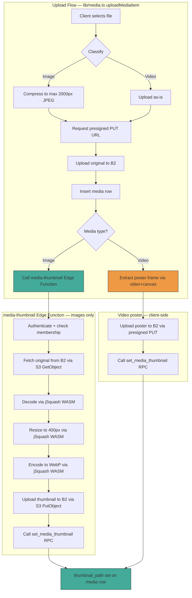

# Media Web Optimizer — Server-Side Thumbnail Generation

## Research Findings & Recommended Approach

### The Problem

Thumbnail displays (timeline cards ~64px, dashboard cards ~64px) currently pull full-resolution originals (up to 2000px edge after client-side compression). This causes real B2 egress costs. The existing code flags this explicitly in [`media.ts`](app/avero/src/lib/media.ts:52) and [`MemoryThumbnail.tsx`](app/avero/src/components/memories/MemoryThumbnail.tsx:66).

### Deno Edge Function Image Processing — Research

Supabase Edge Functions run on **Deno**, not Node.js. The go-to Node image library (`sharp`) uses native libvips bindings and **does not work** in Deno. The options investigated:

| Option | Verdict | Reasoning |
|--------|---------|-----------|
| **jSquash** (WASM codecs) | ✅ **Recommended** | Pure WASM (decode → resize → encode). No native bindings. Supports JPEG/PNG/WebP/AVIF decode, WebP/AVIF/JPEG encode, Lanczos3 resize. Works in Deno via `npm:` imports. High reputation, well-maintained. |
| `wasm-image-optimization` (Deno module) | ⚠️ Backup | Purpose-built for Deno but smaller community, less documentation, less battle-tested than jSquash. |
| External service (Cloudinary/imgix) | ❌ Rejected | Adds cost + dependency. Doesn't fit private B2 architecture (objects are private, presigned URLs are short-lived). Would require making objects public (security regression) or proxying (complexity). |
| `ffmpeg.wasm` (for video frames) | ❌ Not feasible | ~25-30MB WASM binary. Blows past Edge Function deployment size and memory limits. Video frame extraction requires a full codec decoder — no lightweight WASM alternative exists. |

### Output Format: WebP (not AVIF, not JPEG)

| Format | Compression | Encode Speed (WASM) | Browser Support | Verdict |
|--------|------------|---------------------|-----------------|---------|
| AVIF | Best (20-50% smaller) | **Very slow** — risk of hitting Edge Function CPU limits | ~92% | ❌ Encoding slowness risks timeout failures |
| **WebP** | Good (25-35% better than JPEG) | **Fast** | ~97% | ✅ Best balance for Edge Functions |
| JPEG (low quality) | Worst | Fastest | 100% | ❌ Largest files, defeats the purpose |

**Decision: WebP, quality 78, max 400px long edge.**

- 400px long edge gives 6.25x the 64px display size — crisp on 2x/3x retina displays with headroom for minor size increases.
- Quality 78 is visually indistinguishable from the original at thumbnail size while producing small files.
- 97% browser support is sufficient — the fallback to the original handles rare unsupported browsers, and the thumbnail is decorative.

### Video Thumbnails — Honest Assessment

**Server-side video poster frame extraction is not feasible in a Deno Edge Function.** The only WASM video decoder (`ffmpeg.wasm`) is too heavy (~25-30MB) for Edge Function deployment/memory limits. No lightweight alternative exists.

**Recommended approach: client-side poster frame extraction at upload time.**

This is fundamentally different from the browser's `<video> poster behavior` the spec wants to eliminate:
- The browser's `<video preload="metadata">` downloads video bytes **on every thumbnail display** (the problem).
- Client-side extraction at upload time happens **once**, produces a static image, and that image is what gets displayed thereafter — **zero video bytes downloaded at display time**.

The spec says "server-side" but the actual goal is "don't download video bytes for thumbnails." Client-side extraction at upload achieves this goal. This is flagged honestly as a deviation from the literal "server-side" requirement, with the reasoning that it's the only feasible path without external infrastructure.

---

## Architecture

### Key Design Decisions

1. **Separate Edge Function (`media-thumbnail`)** — not added to `media-storage`. The WASM imports (jSquash) should only load for thumbnail generation, not for every URL-signing call. Separation of concerns: `media-storage` does URL signing, `media-thumbnail` does image processing.

2. **`thumbnail_path` column (nullable)** — explicit, not derived. NULL means "no thumbnail variant" (old media or generation failed). The client falls back to the original. The RPCs return it alongside `url`/`storage_path` so batch fetches already have the thumbnail key.

3. **`set_media_thumbnail` RPC (SECURITY DEFINER)** — the existing `media_update` RLS policy only allows `is_memory_creator`, but any Space member can upload media (`media_insert` = `is_space_member`). A narrowly-scoped SECURITY DEFINER function with an explicit `is_space_member` check bridges this asymmetry safely. Matches the `sync_memory_tags` pattern. Only updates `thumbnail_path` — nothing else.

4. **Failure isolation** — thumbnail generation is a separate step AFTER the upload completes. If it fails, the original is untouched and the media row's `thumbnail_path` stays NULL. The client catches the failure silently. The upload is already "done" from the user's perspective.

5. **No backfill** — existing media keeps `thumbnail_path = NULL`, falls back to the original. No regression.

---

## Implementation Plan

### Phase 1: Database Migration

- [ ] **1.1** Create migration `20260725100000_media_thumbnail_path.sql`:
  - `ALTER TABLE media ADD COLUMN thumbnail_path text;` (nullable, no default)
  - Comment documenting the column's purpose and NULL semantics

- [ ] **1.2** Create migration `20260725110000_set_media_thumbnail_rpc.sql`:
  - `CREATE FUNCTION set_media_thumbnail(p_media_id uuid, p_thumbnail_path text) RETURNS void`
  - `SECURITY DEFINER`, `SET search_path = public`
  - Explicit `is_space_member` check (re-derives space_id from the media row's parent memory)
  - Only updates `thumbnail_path` column: `UPDATE media SET thumbnail_path = p_thumbnail_path WHERE id = p_media_id AND is_space_member(...)`
  - `REVOKE ALL FROM PUBLIC; GRANT EXECUTE TO authenticated;`

- [ ] **1.3** Create migration `20260725120000_update_thumbnail_rpcs.sql`:
  - `CREATE OR REPLACE` both `get_timeline_thumbnails` and `get_space_list_thumbnails` to add `thumbnail_path text` to their `RETURNS TABLE` signatures and SELECT lists
  - Additive change — existing callers still work (they just ignore the new column)

### Phase 2: Edge Function — `media-thumbnail`

- [ ] **2.1** Create `supabase/functions/media-thumbnail/index.ts`:
  - New Edge Function with a `generate-thumbnail` action
  - Reuses the auth + membership + B2 client patterns from `media-storage`
  - Imports jSquash via `npm:@jsquash/jpeg`, `npm:@jsquash/webp`, `npm:@jsquash/resize`
  - Flow: authenticate → parse space_id from file_key → check membership → fetch original from B2 (S3 `GetObjectCommand`) → decode (JPEG/PNG/WebP) → resize to 400px max edge (Lanczos3) → encode to WebP (quality 78) → upload thumbnail to B2 (S3 `PutObjectCommand`) → call `set_media_thumbnail` RPC → return `{ thumbnail_key }`
  - Thumbnail key: `{space_id}/{memory_id}/{uuid}_thumb.webp`
  - Non-image content types: return `{ skipped: true }` (videos handled client-side)
  - All failures caught and returned as non-fatal errors — never throws
  - `verify_jwt = false` in `supabase/config.toml` (function does its own JWT verification, same as `media-storage`)

- [ ] **2.2** Add `[functions.media-thumbnail]` section to `supabase/config.toml` with `verify_jwt = false`

### Phase 3: Client Types & Lib

- [ ] **3.1** Update [`app/avero/src/types/media.ts`](app/avero/src/types/media.ts):
  - Add `thumbnail_path: string | null` to the `Media` type

- [ ] **3.2** Update [`app/avero/src/lib/media.ts`](app/avero/src/lib/media.ts):
  - Add `generateThumbnail(fileKey: string, mediaId: string): Promise<void>` — calls the `media-thumbnail` Edge Function, fire-and-forget (failure is non-fatal, logged but not surfaced to user)
  - Add `extractVideoPoster(file: File): Promise<Blob | null>` — creates a `<video>` element, seeks to ~1s, draws to canvas, exports as WebP
  - Add `uploadVideoPoster(poster: Blob, spaceId: string, memoryId: string): Promise<string | null>` — requests presigned PUT URL (reuses existing `request-upload-url` action), uploads poster, returns the thumbnail file key
  - Update `uploadMediaItem` to call thumbnail generation after successful upload:
    - Images: call `generateThumbnail(fileKey, mediaId)` (fire-and-forget, wrapped in try/catch)
    - Videos: call `extractVideoPoster` → `uploadVideoPoster` → `set_media_thumbnail` RPC (fire-and-forget, wrapped in try/catch)
  - Update `deleteMedia` to also delete the thumbnail B2 object when `thumbnail_path` is non-null (in addition to the original)

### Phase 4: Thumbnail Consumer Updates

- [ ] **4.1** Update [`app/avero/src/components/memories/MemoryThumbnail.tsx`](app/avero/src/components/memories/MemoryThumbnail.tsx):
  - In `resolveOne`: when `media.thumbnail_path` is non-null, resolve that key instead of `media.url`
  - When `thumbnail_path` is null, fall back to `media.url` (current behavior — no regression for old media)
  - For videos with a `thumbnail_path`: render an `` (the poster image) instead of `<video>` — zero video bytes downloaded
  - For videos without a `thumbnail_path` (old media): keep the current `<video preload="metadata">` behavior (graceful fallback)

- [ ] **4.2** Verify [`app/avero/src/components/media/MediaGallery.tsx`](app/avero/src/components/media/MediaGallery.tsx) needs NO changes (it uses full-resolution originals for the Memory Detail gallery/lightbox — out of scope per spec)

### Phase 5: Testing & Verification

- [ ] **5.1** Test image upload → verify thumbnail_path is set, thumbnail WebP exists in B2, MemoryThumbnail renders the small variant
- [ ] **5.2** Test video upload → verify poster frame is extracted, uploaded, thumbnail_path is set, MemoryThumbnail renders `` (not `<video>`)
- [ ] **5.3** Test thumbnail generation failure → verify upload still succeeds, thumbnail_path stays NULL, MemoryThumbnail falls back to original
- [ ] **5.4** Test old media (no thumbnail_path) → verify MemoryThumbnail falls back to original (no regression)
- [ ] **5.5** Test media deletion → verify both original and thumbnail B2 objects are deleted

---

## Files to Create/Modify

| File | Action | Purpose |
|------|--------|---------|
| `supabase/migrations/20260725100000_media_thumbnail_path.sql` | **Create** | Add `thumbnail_path` column |
| `supabase/migrations/20260725110000_set_media_thumbnail_rpc.sql` | **Create** | SECURITY DEFINER RPC to set thumbnail_path |
| `supabase/migrations/20260725120000_update_thumbnail_rpcs.sql` | **Create** | Add thumbnail_path to existing thumbnail RPCs |
| `supabase/functions/media-thumbnail/index.ts` | **Create** | Edge Function for server-side image thumbnail generation |
| `supabase/config.toml` | **Modify** | Add `[functions.media-thumbnail]` config |
| `app/avero/src/types/media.ts` | **Modify** | Add `thumbnail_path` to Media type |
| `app/avero/src/lib/media.ts` | **Modify** | Add thumbnail generation + video poster extraction + update upload/delete flows |
| `app/avero/src/components/memories/MemoryThumbnail.tsx` | **Modify** | Prefer thumbnail variant, fall back to original |

---

## Tradeoffs Flagged

1. **Video thumbnails are client-side, not server-side** — server-side video frame extraction is not feasible in Deno Edge Functions (ffmpeg.wasm is too heavy). Client-side extraction at upload time achieves the actual goal (no video bytes at display time) but deviates from the literal "server-side" requirement. Flagged for confirmation.

2. **Server-side image processing requires double network transfer** — the Edge Function fetches the original from B2, processes it, and re-uploads. This happens once at upload time (not on every view), and the Edge Function is in the same region as B2. Acceptable tradeoff for server-side processing.

3. **WebP over AVIF** — AVIF produces smaller files but its WASM encoder is slow enough to risk Edge Function CPU timeouts. WebP is the pragmatic best choice: fast encoding, good compression, 97% browser support.

4. **400px long edge** — overkill for 64px display on 2x screens (128px needed), but ensures crisp rendering on 3x displays and provides headroom for minor thumbnail size increases. A 400px WebP at quality 78 is typically 15-40KB — a 10-50x reduction from a 2000px JPEG original.
