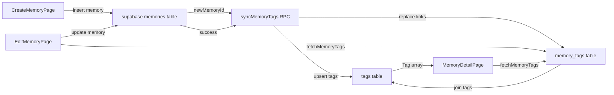

# Tags Feature — Implementation Plan

## 1. Summary & Key Finding

**The database layer for tags already exists.** The initial migration set (`20260703170100_tables.sql`, `20260703170200_constraints.sql`, `20260703170300_indexes.sql`, `20260703170900_enable_rls.sql`, `20260703171000_rls_policies.sql`, `20260705210000_grant_table_privileges.sql`) already defines:

- `tags` table: `id (uuid PK)`, `space_id (uuid NOT NULL FK spaces)`, `name (text NOT NULL)`, `created_at (timestamptz)`
- `memory_tags` junction: `memory_id (uuid FK memories CASCADE)`, `tag_id (uuid FK tags CASCADE)`, composite PK `(memory_id, tag_id)`
- **Case-insensitive uniqueness**: `CREATE UNIQUE INDEX uq_tags_space_name_lower ON tags (space_id, lower(name))` — enforces "duplicate tags not allowed within the same Space" and "case-insensitive" rules at the DB level.
- Supporting indexes: `idx_tags_space_id`, `idx_memory_tags_tag_id`
- RLS enabled + full policy matrix (SELECT/INSERT/UPDATE/DELETE for `tags`; SELECT/INSERT/DELETE for `memory_tags`) — all gated through `is_space_member` / `is_space_owner`.
- Grants: `authenticated` role has SELECT/INSERT/UPDATE/DELETE on both tables.

**Therefore, no new table/constraint/index/RLS migration is needed.** The only new database artifact is a single RPC function for atomic tag upsert + link (see §2).

---

## 2. Dedup Strategy Decision: Postgres RPC (Recommended)

### Decision: Use a Postgres RPC function — `sync_memory_tags(p_memory_id, p_space_id, p_tag_names text[])`

### Why RPC over client-side check-then-insert

| Concern | Client-side check-then-insert | Postgres RPC |
|---|---|---|
| **Race condition** | Two concurrent saves can both SELECT "no existing tag", both INSERT → second hits the unique index and throws `23505`. The client must catch + retry, adding complexity. | Single atomic transaction. `INSERT ... ON CONFLICT (space_id, lower(name)) DO NOTHING` then `SELECT id` — no race window. |
| **Round trips** | N+1: one SELECT to find existing tags, then INSERTs for new tags, then INSERTs into `memory_tags`. | One RPC call does everything. |
| **Partial-failure risk** | Memory created but tag-linking fails mid-way → memory exists with partial tags. | RPC runs after the memory row exists; if it fails, the memory is still saved (tags are non-critical metadata). The RPC itself is atomic — all-or-nothing for the tag set. |
| **Consistency with codebase** | The codebase already uses SECURITY DEFINER helper functions (`is_space_member`, `is_space_owner`, `is_memory_creator`) and trigger functions. An RPC fits the established pattern. | ✅ Consistent. |
| **Edit flow (replace all tags)** | Client must DELETE all existing `memory_tags` then re-INSERT — multiple statements, race-prone. | RPC deletes existing links + inserts new ones in one transaction. |

### Tradeoff flagged (per user request)

The RPC approach adds a Postgres function to maintain. However, the alternative (client-side) would require:
1. A SELECT for existing tags by name (case-insensitive) in the space.
2. INSERTs for missing tags (with `ON CONFLICT DO NOTHING` to handle races — but PostgREST doesn't expose `ON CONFLICT` directly; you'd need `.upsert()` which still isn't atomic across the tag + link tables).
3. INSERTs into `memory_tags`.
4. For edits: a DELETE of removed links.

This is 3+ round trips with real race-condition exposure on the unique index. The RPC collapses this to one call and is the clear winner for data integrity.

### RPC function SQL

```sql
-- ============================================================================
-- Migration: sync_memory_tags RPC function
-- ----------------------------------------------------------------------------
-- Atomic upsert of a Memory's tag set. Given a memory_id, space_id, and an
-- array of tag names, this function:
--   1. Normalizes each name (trim + collapse internal whitespace is left to
--      the client; here we only lower-case for the conflict check).
--   2. INSERTs each tag into `tags` with ON CONFLICT DO NOTHING on the
--      (space_id, lower(name)) unique index — reusing existing tags.
--   3. Fetches the tag ids (existing + newly inserted) for the given names.
--   4. Replaces the memory's memory_tags rows: deletes existing links, then
--      inserts fresh links for the resolved tag set.
--
-- This is atomic (single transaction) and race-condition-free: concurrent
-- calls for different memories are independent; concurrent calls for the same
-- memory serialize on the memory_tags row locks.
--
-- RLS: the function is SECURITY DEFINER so it can read/insert tags and
-- memory_tags without per-statement RLS re-evaluation. Authorization is
-- enforced explicitly at the top: the caller must be a member of the space.
-- (The tags_insert / memory_tags_insert RLS policies would also allow this,
-- but checking once up front is cleaner and faster.)
--
-- Returns: void. Errors propagate to the caller (PostgREST surfaces them as
-- PostgRESTError on the client).
-- ============================================================================

CREATE OR REPLACE FUNCTION sync_memory_tags(
    p_memory_id uuid,
    p_space_id  uuid,
    p_tag_names text[]
)
RETURNS void
LANGUAGE plpgsql
SECURITY DEFINER
SET search_path = public
AS $$
DECLARE
    v_clean_names text[];
BEGIN
    -- Authorization: caller must be a member of the space.
    IF NOT is_space_member(p_space_id) THEN
        RAISE EXCEPTION 'sync_memory_tags: not a member of space %', p_space_id
            USING ERRCODE = 'insufficient_privilege';
    END IF;

    -- Normalize: trim whitespace, drop empties, dedupe case-insensitively.
    -- We keep the original casing of the first occurrence for display.
    SELECT array_agg(DISTINCT trim(name))
    INTO v_clean_names
    FROM unnest(p_tag_names) AS name
    WHERE trim(name) <> '';

    -- 1. Insert any tags that don't yet exist in this space (case-insensitive).
    --    ON CONFLICT reuses the existing row. The unique index is on
    --    (space_id, lower(name)), so the conflict target matches.
    INSERT INTO tags (space_id, name)
    SELECT p_space_id, trim(name)
    FROM unnest(v_clean_names) AS name
    ON CONFLICT (space_id, lower(name)) DO NOTHING;

    -- 2. Replace the memory's tag links: delete all existing, then insert
    --    fresh links for the resolved tag set. This makes the function
    --    idempotent and handles the edit case (add/remove tags) cleanly.
    DELETE FROM memory_tags WHERE memory_id = p_memory_id;

    INSERT INTO memory_tags (memory_id, tag_id)
    SELECT p_memory_id, t.id
    FROM tags t
    WHERE t.space_id = p_space_id
      AND lower(t.name) IN (
          SELECT lower(trim(name)) FROM unnest(v_clean_names) AS name
      );

    -- If v_clean_names is empty, the DELETE above already cleared all tags.
END;
$$;
```

### Migration file

- **Filename**: `supabase/migrations/20260722100000_sync_memory_tags_rpc.sql`
- **Timestamp prefix**: `20260722100000` — follows the existing `YYYYMMDDHHMMSS` convention and sorts after the latest migration (`20260722090000_fix_media_delete_policy.sql`).

---

## 3. Frontend — File Changes

### 3.1 New file: `app/avero/src/types/tag.ts`

TypeScript types for the Tags feature.

```typescript
/**
 * A Tag — a simple label shared within a Space (feature-specs §6, database §10).
 *
 * Tags are case-insensitive and unique per Space (enforced by the
 * `uq_tags_space_name_lower` unique index). The `name` field preserves the
 * original casing as entered by the first user to create it.
 */
export type Tag = {
  id: string;
  space_id: string;
  name: string;
  created_at: string;
};

/**
 * A memory_tags junction row (database §11). Used when fetching a Memory's
 * tags via the `memory_tags` → `tags` join.
 */
export type MemoryTag = {
  memory_id: string;
  tag_id: string;
};
```

### 3.2 New file: `app/avero/src/lib/tags.ts`

Thin data-access helpers for tags. Keeps Supabase query logic out of the page components, consistent with how `lib/media.ts` centralizes media logic.

```typescript
import { supabase } from "./supabase";
import type { Tag } from "../types/tag";

/**
 * Maximum length for a single tag name. The `tags.name` column is `text`
 * with no CHECK constraint, but 50 characters is ample for a label and keeps
 * the chip UI tidy.
 */
export const MAX_TAG_LENGTH = 50;

/**
 * Maximum number of tags a single Memory can have. Prevents abuse and keeps
 * the detail page calm (Design System §1: "simplicity is premium").
 */
export const MAX_TAGS_PER_MEMORY = 10;

/**
 * Fetches the tags linked to a Memory, for display on the Memory Detail page.
 *
 * Uses the `memory_tags` → `tags` join. RLS on both tables ensures only
 * members of the Memory's Space receive rows.
 *
 * Returns the Tag objects sorted alphabetically by name (case-insensitive) for
 * a calm, deterministic display.
 */
export async function fetchMemoryTags(memoryId: string): Promise<Tag[]> {
  const { data, error } = await supabase
    .from("memory_tags")
    .select("tag_id, tags(id, space_id, name, created_at)")
    .eq("memory_id", memoryId);

  if (error) {
    throw error;
  }

  const tags: Tag[] = (data ?? [])
    .map((row) => (row.tags as unknown as Tag[] | Tag) ?? null)
    .flat()
    .filter((t): t is Tag => t !== null);

  return tags.sort((a, b) =>
    a.name.toLowerCase().localeCompare(b.name.toLowerCase())
  );
}

/**
 * Syncs a Memory's tag set atomically via the `sync_memory_tags` RPC.
 *
 * Given the desired set of tag names, this upserts tags (reusing existing
 * Space tags case-insensitively) and replaces the Memory's memory_tags links
 * in a single transaction. Pass an empty array to remove all tags.
 *
 * @param memoryId  The Memory to tag.
 * @param spaceId   The Space the Memory belongs to (tags are Space-scoped).
 * @param tagNames  The desired tag names (will be trimmed + deduped server-side).
 */
export async function syncMemoryTags(
  memoryId: string,
  spaceId: string,
  tagNames: string[]
): Promise<void> {
  const { error } = await supabase.rpc("sync_memory_tags", {
    p_memory_id: memoryId,
    p_space_id: spaceId,
    p_tag_names: tagNames,
  });

  if (error) {
    throw error;
  }
}
```

> **Note on the join shape**: PostgREST returns nested objects for `select("tag_id, tags(...)")`. The helper flattens this. If the nested shape is `tags: { id, ... }` (single object, since each `memory_tags` row has one `tag_id`), the `.flat()` is a no-op safety net. The implementation should verify the exact shape during coding and simplify if needed.

### 3.3 New file: `app/avero/src/components/ui/TagInput.tsx`

A simple, self-contained multi-tag input. **Not** a heavy tag-picker — just a text input where typing Enter or comma adds a chip, and clicking a chip removes it. Consistent with Design System §1 ("simplicity is premium") and §6 ("Inputs: minimal borders, clear focus state").

**Props:**
```typescript
interface TagInputProps {
  id: string;
  label: string;
  helperText?: string;
  value: string[];              // controlled: current tag names
  onChange: (tags: string[]) => void;
  disabled?: boolean;
  error?: string;
  maxTags?: number;             // default MAX_TAGS_PER_MEMORY
  maxLength?: number;           // default MAX_TAG_LENGTH
}
```

**Behavior:**
- Renders a label + a flex-wrap container styled like the existing `TextField` (same border, focus ring, `bg-canvas`, `border-white/10`).
- Inside the container: existing tags as removable chips + a text `<input>` that grows to fill remaining space.
- **Add tag**: on `Enter` or comma keypress, take the trimmed input. If non-empty, not a duplicate (case-insensitive), and under `maxTags`/`maxLength`, append to `value` and clear the input. If duplicate, just clear the input (no error — calm UX).
- **Remove tag**: clicking a chip's × (or pressing Backspace on an empty input to remove the last tag) removes it.
- **Comma handling**: commas are stripped from the input (they're the delimiter, not part of the tag).
- Chips styled as small pills: `rounded-full bg-canvas-raised px-2.5 py-0.5 text-xs text-ink` with a muted × button.

**Chip styling** (matches the existing `memory_type` badge spirit but slightly more subdued since tags are plural):
```
rounded-full bg-canvas-raised px-2.5 py-0.5 text-xs font-medium text-ink-muted
```
The × button: `ml-1 text-ink-disabled hover:text-error`

### 3.4 Modify: `app/avero/src/pages/CreateMemoryPage.tsx`

**Changes:**
1. Import `TagInput`, `syncMemoryTags`, `MAX_TAGS_PER_MEMORY`, `MAX_TAG_LENGTH`.
2. Add state: `const [tags, setTags] = useState<string[]>([]);`
3. Add the `<TagInput>` component in the form, after the Location field and before the Photos & videos section. Label: "Tags", helperText: "Optional".
4. In `handleSubmit`, **after** the memory insert succeeds and `newMemoryId` is obtained (but before/after media upload — tags are independent), call:
   ```typescript
   if (tags.length > 0) {
     await syncMemoryTags(newMemoryId, spaceId, tags);
   }
   ```
   Wrap in try/catch — tag failure should **not** block the memory creation success. If it fails, the memory is still created. Show a brief, calm inline notice on the success screen (e.g. "Memory saved, but tags couldn't be added — edit the Memory to try again") rather than silently dropping them. Use a dedicated state variable (e.g. `tagWarning`) rendered as a muted, non-alarm message above the "Continue to Space" button. This gives the user honest feedback without blocking the success state.
5. Disable the TagInput when `isSubmitting || memoryCreated` (same as other fields).

### 3.5 Modify: `app/avero/src/pages/EditMemoryPage.tsx`

**Changes:**
1. Import `TagInput`, `syncMemoryTags`, `fetchMemoryTags`, `MAX_TAGS_PER_MEMORY`, `MAX_TAG_LENGTH`, `Tag` type.
2. Add state: `const [tags, setTags] = useState<string[]>([]);`
3. In `fetchMemoryForEdit`, after setting the form fields from the loaded memory, also fetch the memory's existing tags:
   ```typescript
   try {
     const existingTags = await fetchMemoryTags(id);
     if (!cancelled) setTags(existingTags.map((t) => t.name));
   } catch {
     // Non-fatal — edit form still works, just without pre-filled tags.
   }
   ```
4. Add the `<TagInput>` component in the form, after the Location field (same position as Create). Label: "Tags", helperText: "Optional".
5. In `handleSubmit`, **after** the `memories` update succeeds, call:
   ```typescript
   await syncMemoryTags(memoryId, spaceId, tags);
   ```
   Then navigate to the detail page. Wrap in try/catch — if tag sync fails, still navigate (the core memory update succeeded) but the tags won't be updated. Alternatively, show a form error and stay. **Recommended**: catch, set a calm form error, and stay on the page so the user can retry (tags are part of the edit intent, so failing silently is worse here than in create). Actually — simpler and consistent: let the error propagate to the existing `catch` block's calm message. But that would hide the fact that the memory *was* updated. 

   **Refined approach**: Do the tag sync first (it's idempotent and safe), then update the memory. No — the memory must exist for tags to link. So: update memory → sync tags → navigate. If tag sync throws, set `formError` to a calm message and do NOT navigate, so the user sees something went wrong. The memory update already committed, but that's fine — re-saving is idempotent.

### 3.6 Modify: `app/avero/src/pages/MemoryDetailPage.tsx`

**Changes:**
1. Import `fetchMemoryTags`, `Tag` type.
2. Add state: `const [tags, setTags] = useState<Tag[]>([]);`
3. In the `fetchMemory` effect, after `setMemory(data as Memory)`, fetch tags:
   ```typescript
   try {
     const memoryTags = await fetchMemoryTags(id);
     if (!cancelled) setTags(memoryTags);
   } catch {
     // Non-fatal — detail page renders without tags.
   }
   ```
4. In the header `<header>` section, after the location `<p>` (or after the type badge row), render the tags as chips:
   ```tsx
   {tags.length > 0 && (
     <div className="mt-3 flex flex-wrap gap-1.5">
       {tags.map((tag) => (
         <span
           key={tag.id}
           className="rounded-full bg-canvas-raised px-2.5 py-0.5 text-xs font-medium text-ink-muted"
         >
           {tag.name}
         </span>
       ))}
     </div>
   )}
   ```
   This matches the existing `memory_type` badge styling (`rounded-full bg-accent-soft px-2.5 py-0.5 text-xs font-medium text-accent-400`) but uses `bg-canvas-raised`/`text-ink-muted` to visually distinguish tags (plural, secondary) from the memory type (singular, primary accent). Both are pill/chip style — consistent family, different emphasis.

---

## 4. Data Flow Summary



---

## 5. Files to Create / Modify — Checklist

| # | File | Action |
|---|------|--------|
| 1 | `supabase/migrations/20260722100000_sync_memory_tags_rpc.sql` | **Create** — RPC function |
| 2 | `app/avero/src/types/tag.ts` | **Create** — `Tag`, `MemoryTag` types |
| 3 | `app/avero/src/lib/tags.ts` | **Create** — `fetchMemoryTags`, `syncMemoryTags`, constants |
| 4 | `app/avero/src/components/ui/TagInput.tsx` | **Create** — multi-tag input component |
| 5 | `app/avero/src/pages/CreateMemoryPage.tsx` | **Modify** — add TagInput + syncMemoryTags on save |
| 6 | `app/avero/src/pages/EditMemoryPage.tsx` | **Modify** — add TagInput + fetch/sync tags |
| 7 | `app/avero/src/pages/MemoryDetailPage.tsx` | **Modify** — fetch + display tags as chips |

---

## 6. Open Questions / Risks

1. **RPC return type**: The `sync_memory_tags` function returns `void`. PostgREST handles `void` returns fine (`{ data: null, error: null }` on success). No issue expected.

2. **Tag name normalization**: The RPC trims and dedupes, but does **not** collapse internal whitespace (e.g., "road  trip" → stays as-is). The client should trim before sending. If stricter normalization is desired, add `regexp_replace(trim(name), '\s+', ' ', 'g')` in the RPC. **Recommendation**: keep it simple — trim only, matching the existing codebase's trim-only pattern.

3. **Orphaned tags**: When a memory's tags are all removed (edit → empty tag set), the `tags` rows remain in the `tags` table (they're Space-shared). This is correct behavior — another memory may use the same tag. There's no cleanup of unused tags in MVP, which is fine (tags are small rows). A future cleanup job could remove tags with zero `memory_tags` references, but that's out of scope.

4. **PostgREST nested join shape**: The `fetchMemoryTags` helper assumes `select("tag_id, tags(id, space_id, name, created_at)")` returns `tags` as a nested object. This should be verified during implementation and the flattening logic simplified if the shape is cleaner than expected. An alternative simpler query: select from `tags` directly with a filter on `memory_tags` — but PostgREST doesn't support reverse-join filtering cleanly, so the forward join from `memory_tags` is the standard approach.

5. **Edit page tag-sync failure handling**: If `syncMemoryTags` fails after the memory update succeeds, the memory is updated but tags are stale. The plan sets a form error and stays on the page. The user can retry. This is the safest UX — no silent failure, no lost intent.
