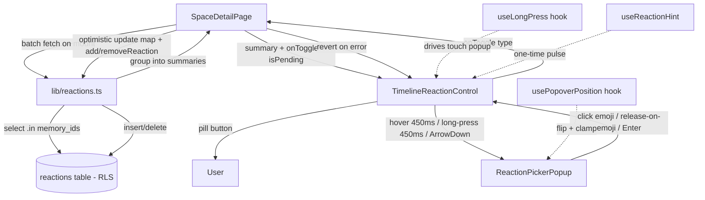

# Plan: Inline Reactions on the Space Timeline Memory Cards

Feature-specs §5 (Reactions) · database §9 (Reactions) · Design System §6/§7/§8

## Context & key discovery

The **entire backend for Reactions already exists** — no new migration is needed:

- **Table** — `reactions` (migration `20260703170100`) with `id`, `memory_id` (FK CASCADE), `user_id` (FK CASCADE), `type` (stable text enum, NOT emoji), `created_at`.
- **CHECK** — `chk_reactions_type` allows only `heart|laugh|fire|tearful|clap|surprised`.
- **UNIQUE** — `uq_reactions_memory_user_type` enforces "one reaction per type per user per Memory" (feature-specs §5).
- **RLS** — `reactions_select` = Space member, `reactions_insert` = member + own, `reactions_delete` = own. No UPDATE by design (toggle via DELETE + INSERT).
- **Index** — `idx_reactions_memory_id`.
- **Grants** — SELECT/INSERT/DELETE to `authenticated`.

So this is a **frontend-only** task. The existing [`lib/reactions.ts`](../app/avero/src/lib/reactions.ts:1) and [`types/reaction.ts`](../app/avero/src/types/reaction.ts:1) are reused **without duplication**.

### What already exists and is reused as-is

| Asset | Location | Reuse |
|---|---|---|
| `ReactionType`, `REACTION_TYPES`, `REACTION_EMOJI`, `REACTION_LABELS`, `asReactionType` | [`types/reaction.ts`](../app/avero/src/types/reaction.ts:1) | Imported directly — the six emoji + labels are the single source of truth |
| `MemoryReactionSummary` (`{counts, mine}`) | [`lib/reactions.ts`](../app/avero/src/lib/reactions.ts:64) | The shared summary shape, produced by the new batch fetch |
| `addReaction`, `removeReaction` | [`lib/reactions.ts`](../app/avero/src/lib/reactions.ts:176) | Called unchanged for optimistic toggles |
| `ReactionBar.tsx` (detail page) | [`components/reactions/ReactionBar.tsx`](../app/avero/src/components/reactions/ReactionBar.tsx:1) | **Not modified, not extended.** Its interaction model (always-visible 6-pill row) is fundamentally different from the timeline's single-pill + Facebook popup. A new sibling component is created instead. |

### Why a new component instead of extending ReactionBar

[`ReactionBar`](../app/avero/src/components/reactions/ReactionBar.tsx:64) renders all six pills permanently, fetches its own single Memory, and has no popup/long-press/viewport-flip logic. The timeline needs the **opposite**: one compact pill per card, a hover/long-press-triggered popup, viewport-aware positioning, and batch-fetched shared state. Forcing both models into one component would create a flag-driven fork that's harder to maintain than two focused components sharing the same lib + types. This mirrors how the codebase already keeps `CommentList` (detail) separate from any future timeline comment affordance.

## Architecture



### Required structural adjustment to the card (NOT a redesign)

The current timeline card is a single [`<Link>`](../app/avero/src/pages/SpaceDetailPage.tsx:306) wrapping the entire card body. A `<button>` (the reaction pill) **cannot be nested inside an `<a>`** — it's invalid HTML and breaks accessibility. The minimal, visually-identical change:

- The outer element becomes a `<div>` with the **same** card classes (`rounded-xl border … bg-canvas-soft p-5 …`).
- The **title** becomes the `<Link>` (keeps the card navigable to the Memory detail).
- The reaction pill is a **sibling** `<button>` inside the card `<div>`, placed in a new footer row below the description.

The card looks the same; only the DOM nesting is corrected so the pill is valid. This is explicitly **not** a layout redesign (out of scope) — it's the smallest change that makes a nested interactive control legal.

## Batch reaction fetch strategy (avoids N+1)

[`fetchMemoryReactions`](../app/avero/src/lib/reactions.ts:94) does one select per Memory. On a timeline with N Memories that's N round trips. A new **batch** function is added to `lib/reactions.ts`:

```ts
export async function fetchMemoryReactionsBatch(
  memoryIds: string[],
  currentUserId: string,
): Promise<Record<string, MemoryReactionSummary>>
```

- One query: `supabase.from("reactions").select("memory_id, type, user_id").in("memory_id", memoryIds)`.
- RLS auto-filters to the Space's members (same as the single fetch); a non-member gets an empty result.
- Client-side grouping: iterate rows, `asReactionType` each, bucket by `memory_id`, seed every type at 0 for every requested id (so cards with zero reactions still get a well-formed summary), and build `mine` per Memory.
- **Refactor to avoid duplication:** extract the per-row accumulation (`counts[type] += 1; if user_id === currentUserId mine.add(type)`) into a small private helper `accumulateReactionRow(row, currentUserId, counts, mine)` used by **both** the existing single fetch and the new batch fetch. The single fetch keeps its signature (back-compat for `ReactionBar`).
- Empty `memoryIds` → return `{}` without a round trip (defensive; the timeline always has ≥1 when rendered).

The page calls `fetchMemoryReactionsBatch` once after the memories list loads (in the existing `useEffect`, alongside the space/memories fetch or in a follow-up effect keyed on `memories`), stores `Record<memoryId, MemoryReactionSummary>` in state, and passes each Memory's summary down to its `TimelineReactionControl` as a prop. The control never fetches on its own — the page is the single source of truth.

## Component structure

### 1. `TimelineReactionControl.tsx` (new) — the pill + popup owner

Path: `app/avero/src/components/reactions/TimelineReactionControl.tsx`

Props:
```ts
type TimelineReactionControlProps = {
  memoryId: string;
  currentUserId: string;
  summary: MemoryReactionSummary;        // from batch cache (page-owned)
  isPending: ReactionType | null;         // which type is mid-flight (page-owned)
  onToggle: (type: ReactionType) => void; // optimistic add/remove/switch (page-owned)
};
```

Responsibilities:
- **Default pill** — always visible, pill-shaped (`rounded-full`), shows:
  - The user's current reaction **emoji** if `summary.mine.size > 0` (the *specific* emoji, e.g. 🔥 if they reacted fire — not a heart).
  - A neutral **outline heart icon** if `mine` is empty (new `HeartIcon` outline in `icons.tsx`, matching Design System §9 outline style).
  - The **total count** across all types (`sum of counts`) when `> 0`, right-aligned, `tabular-nums`.
  - `aria-pressed` = whether the user has *any* reaction (heart-or-other). `aria-label` conveys state + count, consistent with [`ReactionPill`](../app/avero/src/components/reactions/ReactionBar.tsx:247) ("React with Heart" / "Remove Heart reaction" / "You reacted with Fire, N total").
- **Quick toggle (desktop click + mobile tap)** — `onClick` toggles the **heart** default:
  - No reaction → add `heart`.
  - Already `heart` → remove `heart`.
  - Another type (e.g. `fire`) → switch to `heart` (remove `fire`, add `heart` — two calls, or a single `onToggle("heart")` that the parent resolves to "remove old + add heart"). The parent handles the switch atomically.
- **Desktop hover popup** — `onMouseEnter` starts a 450ms timer; on fire → open popup; `onMouseLeave` (pill) cancels the timer if not yet open, or starts a close-delay if open. Moving onto the popup clears the close timer; leaving both closes. (Standard hover-intent pattern.)
- **Mobile long-press popup** — wired via `useLongPress` (see below). Quick tap → heart toggle (the hook distinguishes tap from long-press). Long-press → open popup; while holding, finger-over-emoji highlights; release-on-emoji → apply; release-off → cancel.
- **Keyboard** — pill is `<button>`; `Enter`/`Space` → heart toggle; `ArrowDown` (or `Alt+ArrowDown`) → open picker as a `role="menu"` and focus first emoji; `Esc` closes and returns focus to pill; arrow keys move between emojis; `Enter`/`Space` on an emoji selects. `aria-haspopup="menu"`, `aria-expanded`.
- **Popup rendering** — delegates to `ReactionPickerPopup` (below) for the emoji row; owns open/close + positioning via `usePopoverPosition`.
- **Discoverability hint** — applies a one-time pulse class via `useReactionHint` (see below).

### 2. `ReactionPickerPopup.tsx` (new) — the six-emoji row

Path: `app/avero/src/components/reactions/TimelineReactionControl.tsx` (co-located, or a small subcomponent in the same file to keep the feature cohesive). Renders the six emoji from `REACTION_TYPES`/`REACTION_EMOJI` as `role="menu"` / `role="menuitemradio"` buttons, highlighting the user's current type. Purely presentational + emits `onSelect(type)`. Reuses `REACTION_LABELS` for aria-labels. Calm enter animation (opacity + slight rise, ~150ms, Design System §7).

### 3. `useLongPress.ts` (new hook) — the touch primitive

Path: `app/avero/src/hooks/useLongPress.ts`

A proper long-press primitive, **not** a hand-rolled `setTimeout` on raw touch events. Returns handlers to spread on the pill (`onTouchStart`, `onTouchMove`, `onTouchEnd`, `onTouchCancel`) plus state (`isLongPressing`, `activeEmojiIndex`).

Behavior:
- **Threshold:** 450ms (within the 400–500ms spec).
- **Start:** on `touchstart`, record start touch + start a timer. Call `e.preventDefault()` is **not** done on touchstart (would block scroll); instead use `touch-action: manipulation` CSS on the pill to suppress double-tap zoom, and cancel on movement.
- **Cancel on drag-off / scroll:** on `touchmove`, if the finger moves beyond a small tolerance (e.g. 10px) from the start point → cancel the timer (treat as scroll, not a long-press). While long-pressing and the popup is open, `touchmove` updates `activeEmojiIndex` via `document.elementFromPoint(clientX, clientY)` (find the emoji under the finger).
- **Quick tap:** `touchend` before the threshold → do **not** open the popup; signal a tap so the pill's `onClick` (or a tap callback) toggles heart. (We ignore emulated mouse events by checking `e.pointerType` / using a `touchHandled` flag so the synthetic `click` doesn't double-fire.)
- **Long-press + release on emoji:** `touchend` after the timer fired → if `activeEmojiIndex !== null` → `onSelect(type)`; else cancel (close popup, no change).
- **Ignore emulated mouse events:** the hook sets a flag on real touch handling; the pill's `onClick` checks `pointerType === "touch"` is excluded, or we use `onPointerDown/Up` with `pointerType` checks as the unified path. **Decision:** use the **Pointer Events** API (`onPointerDown/Move/Up`) with `pointerType` discrimination as the primary primitive — it unifies mouse + touch + pen, natively distinguishes `pointerType`, and avoids the mouse-emulation problem entirely. `touch-action: manipulation` on the pill prevents scroll/zoom conflicts. This is cleaner than raw touch events and is the modern recommended primitive.
- **Prevent scroll conflict:** `touch-action: manipulation` (CSS) + cancel-on-move threshold. The popup, once open, can set `touch-action: none` on its overlay to allow sliding without scrolling.

### 4. `usePopoverPosition.ts` (new hook) — viewport-aware flip + clamp

Path: `app/avero/src/hooks/usePopoverPosition.ts`

No existing popover-flip pattern exists ([`MediaLightbox`](../app/avero/src/components/media/MediaLightbox.tsx:130) is a full-screen fixed overlay, not a positioned popover), so this is new. Given a trigger ref and popup dimensions, returns `{ style, placement }`:
- Measure trigger via `getBoundingClientRect()`.
- If `trigger.top - popupHeight - margin < 8` → flip **below** the pill; else default **above**.
- Clamp horizontal: `left = clamp(trigger.left + trigger.width/2 - popupWidth/2, 8, viewportWidth - popupWidth - 8)`.
- Use `position: fixed` with computed `top`/`left` (avoids offsetParent/transform-ancestor issues — matches how an overlay should behave).
- Recompute on open, on `scroll`, and on `resize` (listeners cleaned up). A small `useLayoutEffect` after open.

### 5. `useReactionHint.ts` (new hook) — one-time discoverability pulse

Path: `app/avero/src/hooks/useReactionHint.ts`

- Reads `localStorage.getItem("avero.reactionHintSeen")`.
- If absent → returns `showHint = true` for the **first** `TimelineReactionControl` that mounts (a module-level "already shown this session" guard so only one card pulses, not every card). After the first render with the hint, set the localStorage flag and the module guard.
- The control applies a `reaction-hint-pulse` class (CSS keyframe in `index.css`) — a **single**, calm, ~1.2s soft accent box-shadow pulse, once. No tooltip, no modal, no interaction blocking (Design System §7).
- **Respects `prefers-reduced-motion`:** if reduced motion, skip the animation and instead show a single static subtle accent ring for ~2s (still calm), or skip entirely. The global rule in [`index.css`](../app/avero/src/index.css:17) already shortens transitions to 0.01ms; the keyframe will be authored to be near-instant under reduced motion.

### 6. `HeartIcon` (new) — outline heart for the neutral pill state

Path: add to [`components/ui/icons.tsx`](../app/avero/src/components/ui/icons.tsx:1). Outline, `strokeWidth="1.5"`, matching the existing icon set (Design System §9). Used only when the user has **no** reaction; once reacted, the actual emoji replaces it.

## Files to create

1. **`app/avero/src/hooks/useLongPress.ts`** — Pointer-Events-based long-press primitive (threshold, drag-off cancel, tap vs. hold, emulated-event suppression, finger-over-emoji tracking).
2. **`app/avero/src/hooks/usePopoverPosition.ts`** — viewport-aware flip-below + horizontal clamp via `getBoundingClientRect`, `position: fixed`, recompute on scroll/resize.
3. **`app/avero/src/hooks/useReactionHint.ts`** — one-time localStorage-gated pulse flag with a module-level "shown this session" guard.
4. **`app/avero/src/components/reactions/TimelineReactionControl.tsx`** — the pill + popup owner (default pill, quick toggle, hover popup, long-press popup, keyboard menu, hint). Includes the `ReactionPickerPopup` subcomponent (or a co-located file) rendering the six emoji as a `role="menu"`.

## Files to modify

5. **`app/avero/src/lib/reactions.ts`** — add `fetchMemoryReactionsBatch(memoryIds, currentUserId)`; extract the shared row-accumulation helper used by both the single and batch fetches. **No change** to `fetchMemoryReactions`/`addReaction`/`removeReaction` signatures (back-compat for `ReactionBar`).
6. **`app/avero/src/components/ui/icons.tsx`** — add `HeartIcon` (outline).
7. **`app/avero/src/index.css`** — add the `reaction-hint-pulse` keyframe (calm, single, accent glow) + a reduced-motion-safe variant.
8. **`app/avero/src/pages/SpaceDetailPage.tsx`** —
   - Add `useAuth()` for `currentUserId`.
   - Add `reactionsByMemoryId` state + a batch fetch effect (calls `fetchMemoryReactionsBatch` after memories load; cancelled-flag pattern like the existing fetch).
   - Add an `onToggleReaction(memoryId, type)` handler: optimistic update of the `reactionsByMemoryId` map (toggle/switch/remove), call `addReaction`/`removeReaction`, revert on error (mirrors [`ReactionBar.handleToggle`](../app/avero/src/components/reactions/ReactionBar.tsx:120) but operating on the map). Track `pendingByMemoryId` for the in-flight type per card.
   - Restructure the card `<li>`: outer `<div>` (card styles), title as `<Link>`, add a footer row rendering `<TimelineReactionControl>` (only when `user` is present, matching the `MemoryDetailPage` gate).
   - **No** change to search, empty states, or header.

## No backend changes

No new migration. Table, RLS, CHECK, UNIQUE, index, and grants all exist.

## Interaction model summary (Facebook-style)

| Input | Action | Result |
|---|---|---|
| Desktop click on pill | quick | toggle heart (add / remove / switch-to-heart) |
| Desktop hover pill 450ms | hover-intent | open 6-emoji popup above (or below if near top) |
| Desktop move to emoji + click | select | set that reaction (replace existing) |
| Desktop leave pill + popup | — | close, no change |
| Mobile tap pill | quick | toggle heart |
| Mobile press-and-hold 450ms | long-press | open popup; slide finger to highlight |
| Mobile release on emoji | select | apply that reaction |
| Mobile release off / drag-off before threshold | — | cancel, no change |
| Keyboard Enter/Space on pill | — | toggle heart |
| Keyboard ArrowDown on pill | — | open picker menu, focus first emoji |
| Keyboard arrows in menu | navigate | move between emojis |
| Keyboard Enter/Space in menu | select | apply that reaction |
| Keyboard Esc | — | close popup, focus back to pill |

## Accessibility

- Pill is a `<button>` with `aria-pressed` (has any reaction) and a descriptive `aria-label` (state + total count), consistent with [`ReactionPill`](../app/avero/src/components/reactions/ReactionBar.tsx:259).
- `aria-haspopup="menu"` + `aria-expanded` on the pill; popup is `role="menu"`, emojis are `role="menuitemradio"` with `aria-checked` for the current type.
- Keyboard path to the full picker is **explicit** (`ArrowDown` opens the menu) — not a timer-based "focus after delay" guess, so keyboard users have a reliable, discoverable route.
- Focus is moved into the menu on open and returned to the pill on `Esc`/selection (matches [`MediaLightbox`](../app/avero/src/components/media/MediaLightbox.tsx:78) focus management).
- `prefers-reduced-motion` respected (global rule + hint variant).

## Patterns reused (consistency)

| Concern | Existing pattern | Reused here |
|---|---|---|
| Auth gate | `ProtectedRoute` + RLS; `useAuth().user.id` | same — page already member-gated |
| Lib never throws | `addReaction`/`removeReaction` return `{ok, error}` | called unchanged |
| Optimistic + revert | [`ReactionBar.handleToggle`](../app/avero/src/components/reactions/ReactionBar.tsx:120) snapshot/revert | same pattern, applied to the batch map |
| No confirm dialog | reactions are low-stakes toggles | same — single tap is the whole action |
| Refresh-based, not realtime | database §14 "No real-time systems needed yet" | same — own action updates local state; others appear on reload |
| Calm error | `text-error` inline, clears on next interaction | same |
| Outline icons | Design System §9, `icons.tsx` set | new `HeartIcon` matches the set |
| Focus management | [`MediaLightbox`](../app/avero/src/components/media/MediaLightbox.tsx:78) focus + cleanup | same approach for the popup menu |
| Reduced motion | [`index.css`](../app/avero/src/index.css:17) global rule | hint keyframe honors it |

## Out of scope (per brief)

- Comment reactions.
- Realtime sync without refresh.
- Redesign of the existing card layout (only the minimal DOM-nesting fix for valid `<button>` placement).

## Implementation order (for the Code mode pass)

1. `lib/reactions.ts` — extract row-accumulation helper + add `fetchMemoryReactionsBatch`.
2. `components/ui/icons.tsx` — add `HeartIcon`.
3. `hooks/usePopoverPosition.ts`.
4. `hooks/useLongPress.ts`.
5. `hooks/useReactionHint.ts`.
6. `index.css` — add `reaction-hint-pulse` keyframe (+ reduced-motion variant).
7. `components/reactions/TimelineReactionControl.tsx` (+ `ReactionPickerPopup`).
8. `pages/SpaceDetailPage.tsx` — batch fetch state, `onToggleReaction`, card restructure, render the control.
9. Manual smoke test: quick toggle (add/remove/switch), hover popup, long-press + slide-to-emoji + release, drag-off cancel, viewport flip near top, horizontal clamp, keyboard menu, hint shows once then never, optimistic revert on simulated error, reduced-motion.
